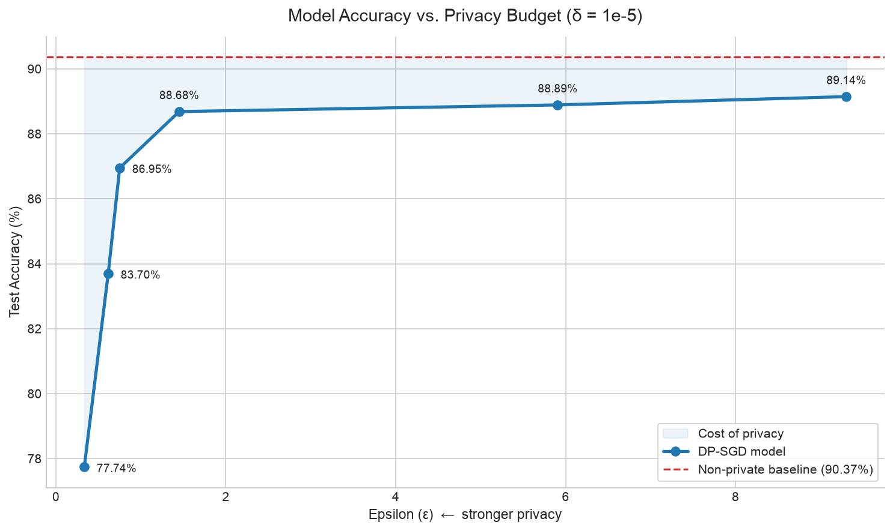
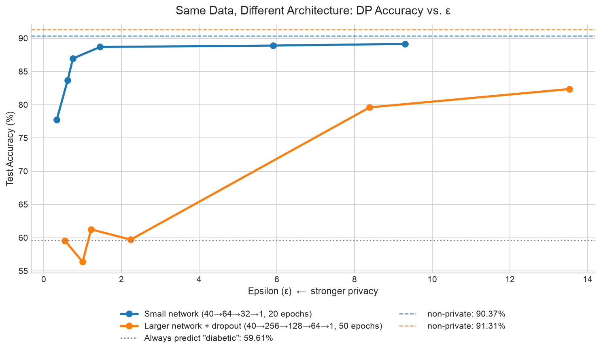

# Differentially Diagnosed: Privacy and Utility Tradeoffs in Medical Risk Prediction

> Final project for **CS 3110 – Data Privacy**. I trained a differentially private neural network to predict diabetes, then measured how much accuracy the model gives up as the privacy guarantee gets stronger.
> **Stack:** Python, PyTorch, Opacus

## Why I Made This
The Data Privacy final project had several options. We could contribute to OpenDP's collection of real-world differential privacy deployments, analyze an existing deployment, or take a new dataset and apply differential privacy to it ourselves. As the semester went on, I kept doing extra reading after every class because I found differential privacy so interesting, so I picked the hands-on option and decided to go well beyond the minimum.

Medical data was a natural fit. A diabetes risk model is only useful if it is trained on real patient records, and those are exactly the records that should never leak.

## The Setup
* **Dataset:** **100,000 synthetic patient records** from Kaggle, with 28 features covering demographics, lifestyle factors, vitals and lab results. The target is `diagnosed_diabetes` (60% positive). The data is synthetic, not real patient data.
* **Avoiding leakage:** I dropped `diabetes_stage` and `diabetes_risk_score`, because both effectively encode the label.
* **Preprocessing:** one-hot encoding, an 80/20 train/test split, and a `StandardScaler` fit on the training set only.
* **Model:** a small MLP (40 → 64 → 32 → 1) with ReLU activations, a sigmoid output and binary cross-entropy loss.
* **Baseline:** SGD (learning rate **0.1**, momentum **0.9**), batch size **64**, **50** epochs. It reached **90.37%** test accuracy without any privacy.
* **Private model:** the same network trained with **DP-SGD** through [Opacus](https://opacus.ai): clipping norm $C = 1.0$, learning rate **0.05**, batch size **64**, **20** epochs, with $\delta = 10^{-5}$.

Random seeds are fixed, and each sweep writes its numbers to CSV files, so the graphs are built from the saved results rather than typed in by hand.

### How DP-SGD Works
In normal SGD, every training example's gradient feeds straight into the update, so a single unusual patient can noticeably move the model. DP-SGD limits that influence in two steps:
1. **Clip** each example's gradient to a maximum norm $C$, which bounds how much any one person can contribute.
2. **Add Gaussian noise** scaled by a *noise multiplier* $\sigma$ to the summed gradients before taking the step.

Opacus tracks how much privacy is spent over the whole training run and reports the resulting $(\varepsilon, \delta)$ guarantee. A smaller $\varepsilon$ means stronger privacy.

## Results
I swept the noise multiplier from **0.45 to 1.5**, which corresponds to **$\varepsilon$ from 9.30 down to 0.33**, and compared each run to the non-private baseline.

| Model | Noise multiplier ($\sigma$) | $\varepsilon$ | Test accuracy |
|---|---|---|---|
| Non-private baseline | – | $\infty$ | **90.37%** |
| DP-SGD | 0.45 | 9.30 | 89.14% |
| DP-SGD | 0.50 | 5.91 | 88.89% |
| DP-SGD | 0.70 | 1.45 | **88.68%** |
| DP-SGD | 0.90 | 0.75 | 86.95% |
| DP-SGD | 1.00 | 0.62 | 83.70% |
| DP-SGD | 1.50 | 0.33 | **77.74%** |

**Key findings:**
* **Privacy costs very little at moderate $\varepsilon$.** At $\varepsilon = 9.3$ the model loses about 1.2 points of accuracy, and at $\varepsilon = 1.45$, which is a fairly strong guarantee, it loses only about 1.7 and keeps **98%** of the baseline accuracy.
* **There is a cliff.** Utility drops sharply once $\varepsilon$ goes **below about 0.6**, falling to 77.7% at $\varepsilon = 0.33$. Past that point the noise overwhelms the signal from the gradients.

So for this task there is a broad range where you can get meaningful privacy almost for free, but you can't push the guarantee arbitrarily far.

## Follow-up Experiment: A Larger Network
After the semester, I tried a four-layer network (40 → 256 → 128 → 64 → 1, about **11×** the parameters) with dropout **0.2**, trained with DP-SGD for **50** epochs.

| $\sigma$ | $\varepsilon$ (small) | Small network | $\varepsilon$ (large) | Larger network |
|---|---|---|---|---|
| – | $\infty$ | 90.37% | $\infty$ | **91.31%** |
| 0.45 | 9.30 | **89.14%** | 13.54 | 82.36% |
| 0.50 | 5.91 | **88.89%** | 8.39 | 79.60% |
| 0.70 | 1.45 | **88.68%** | 2.24 | 59.72% |
| 0.90 | 0.75 | **86.95%** | 1.22 | 61.25% |
| 1.00 | 0.62 | **83.70%** | 1.00 | 56.37% |
| 1.50 | 0.33 | **77.74%** | 0.54 | 59.57% |

Without privacy, the larger network wins. With privacy, it loses at every noise level. From $\varepsilon \approx 2.2$ down, it scores about the same as **predicting "diabetic" for every patient (59.6%)**, which means it learns nothing useful. There are two reasons:
* **The noise is spread over more weights.** Each example's gradient is clipped to the same total norm ($C = 1.0$), but that norm is now spread across about 11× as many weights, and every weight gets the same amount of noise. The signal per weight is far smaller relative to the noise.
* **More epochs cost more privacy.** 50 noisy passes over the data instead of 20 give a higher $\varepsilon$ for the same $\sigma$ (13.54 vs. 9.30 at $\sigma = 0.45$).

The lesson is that design choices that help without privacy don't automatically carry over to DP-SGD.

## Further Ideas
* **Predicting diabetes stage:** use the `diabetes_stage` column I dropped as a multiclass target. The task would be harder under DP noise.
* **Tuning with privacy in mind:** tune batch size, clipping norm and learning rate together with the noise multiplier, instead of reusing the settings from the non-private model.
* **Production-grade randomness:** turn on Opacus `secure_mode` for a cryptographically secure random number generator.

## Code
The repository includes both notebooks (the main project and the larger-network follow-up), the saved results, and a glossary of the DP and ML terms used: [dp-medical-test-classifier](https://github.com/shamusmurphy/dp-medical-test-classifier)

Related: [[Foundations of Secure Aggregation]], a different approach to privacy-preserving computation, where the protection comes from cryptography instead of noise.
