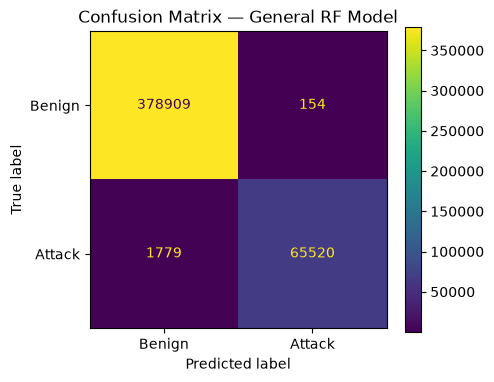
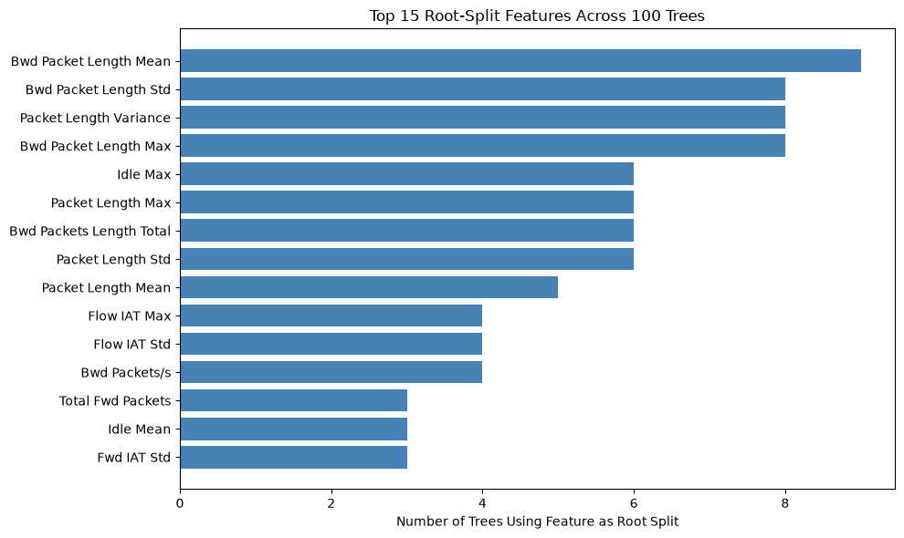
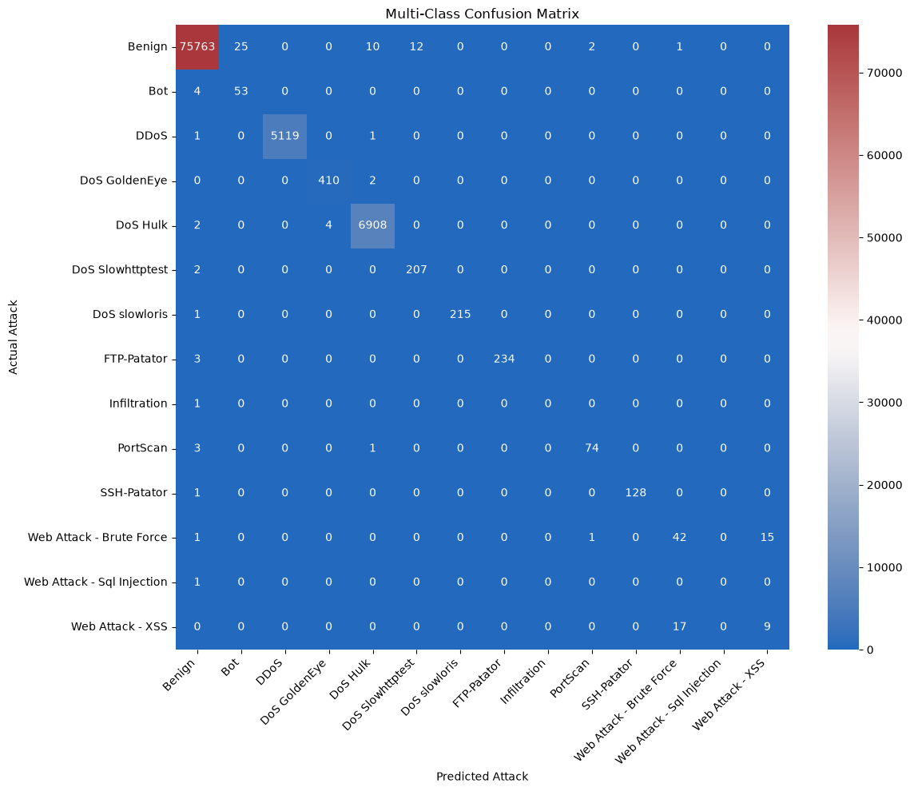
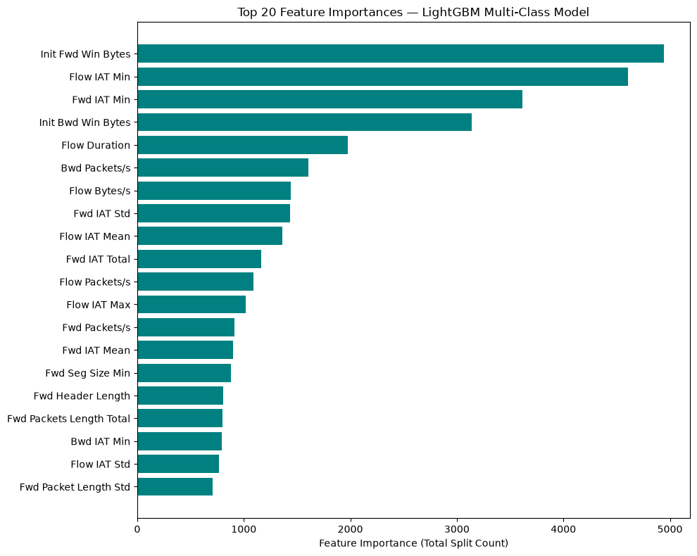

# Network Intrusion Detection on CIC-IDS2017

> Final project for **CS 3870 – Data Science Pinnacle**. I led a team of three building an intrusion detection system with random forests and gradient boosting.
> **Stack:** Python, pandas, NumPy, scikit-learn, LightGBM, matplotlib, seaborn

The **CIC-IDS2017** dataset is a standard benchmark for intrusion detection. It contains about **2.3 million labeled network flows** captured over a five-day work week, mixing benign traffic with **14 attack types** (DoS, DDoS, brute force, web attacks such as XSS, port scans, botnets and more). That makes it a lot closer to real-world network data than older benchmarks. We used the parquet version from Kaggle because it downloads faster and loads more efficiently than the raw CSVs.

## Goals
1. **Detection:** decide whether a network flow is benign or an attack (binary classification).
2. **Identification:** if it is an attack, decide *which* attack it is (multiclass classification).
3. **Interpretation:** work out which traffic features drive these decisions.

## Data Cleaning
I built the preprocessing pipeline. The raw data needed a lot of work before any model could use it:
* **2,313,810 network flows** across 78 feature columns to start with.
* **Removed 82,004 duplicate rows**, so that identical flows could not end up in both the training and test sets and make our scores look better than they were. That left about 2.23 million flows.
* **Handled infinite flow-rate values.** `Flow Bytes/s` and `Flow Packets/s` become infinite when a flow's duration is zero. We first dropped those rows, but that threw away attack samples the multiclass model needed, so instead we replaced the infinities with each column's largest finite value. Very large rates are exactly what DoS traffic looks like, so keeping them matters.
* **Removed redundant features** (bulk-rate columns, unused TCP flag columns, subflow columns that just subdivide the totals, and average columns that duplicate existing means), cutting **78 raw columns down to 60 features**.
* **One-hot encoded `Protocol`** (TCP, UDP, other) and scaled features with a **`RobustScaler`**, which is less sensitive to the heavy outliers in this data.

The `Label` column was encoded twice: `0` for benign and `1` for any attack for the binary task, and one integer per class for the multiclass task. All train/test splits are stratified so every class keeps its proportions.

## Model 1: Random Forest (Binary Detection)
We trained a random forest (100 trees, max depth 10) to separate benign traffic from attacks and evaluated it on **446,362 held-out flows**:

| Class | Precision | Recall | F1 |
|---|---|---|---|
| Benign | 1.00 | 1.00 | 1.00 |
| Attack | **1.00** | **0.97** | **0.99** |

Overall accuracy is about **99.6%**, and the model misclassifies fewer than 2,000 flows. The errors are lopsided, though: about **1,700 missed attacks** (false negatives) against only about **130 false alarms** (false positives). A low false-positive rate matters in real deployments, because analysts quickly start ignoring a noisy IDS. But a missed attack is the more costly mistake, so recall is the thing to improve next, for example by lowering the decision threshold.

To see what the forest relies on, we counted which feature each of the 100 trees chose for its very first split. Since each tree greedily picks the split that most reduces Gini impurity, the root split is a good signal of importance. **Packet-length statistics** (mostly on the backward direction) dominate, but no single feature is chosen by more than 9% of trees.

## Model 2: Weighted LightGBM (Attack Identification)
Next I built a **LightGBM** classifier that labels each flow as benign or one of the specific attacks. To keep training time reasonable, it was trained on a stratified 20% sample of the data. This task is much harder, because the class distribution is extremely skewed: about 1.9 million flows are benign, while Heartbleed has **11** examples in the entire dataset.

To deal with this, we used **`class_weight='balanced'`** so the model could not get a good loss just by predicting the majority classes. The high-volume attacks are identified almost perfectly, with **0.97–1.00 F1** on:
* DDoS
* DoS Hulk, GoldenEye, slowloris and Slowhttptest
* FTP and SSH brute force (Patator)

PortScan comes in at 0.95. Overall accuracy rounds to 1.00, but that number is dominated by benign traffic. The **macro-averaged F1 of 0.77**, which weights every class equally, gives a more honest picture of where the model struggles:
* **Web Attack Brute Force vs. XSS** are often confused with each other (F1 0.71 and 0.36). Both target the same web application, so their flow statistics look very similar.
* **Infiltration, SQL Injection and Heartbleed** have only 11–36 samples in the whole dataset. After sampling, just one Infiltration and one SQL Injection flow landed in the test set, so the model can't meaningfully learn or be evaluated on them.

Interestingly, LightGBM leans on different features than the random forest. Its most-used features are the **initial TCP window sizes** (`Init Fwd Win Bytes`, `Init Bwd Win Bytes`) and **inter-arrival timing** (`Flow IAT Min`, `Fwd IAT Min`), rather than packet lengths. Again, no single feature dominates.

## Limitations
* **Optimistic scores.** CIC-IDS2017 has known labeling and flow-construction artifacts that make it easier than real traffic, so near-perfect scores here overstate real-world performance.
* **Random train/test split.** Flows from the same attack session can land in both the training and test sets. Splitting by day or by session would be a stricter test of generalization.
* **Rare classes.** Oversampling (e.g. SMOTE), training on the full dataset for rare classes, or merging similar attacks would help.
* **Dataset age.** The traffic is from 2017, and current attacks and network behavior may look different.

## Takeaways
* **Cleaning mattered as much as modeling.** Duplicates and infinite values in CIC-IDS2017 can quietly inflate results, or quietly throw away the rare attacks you most need, if you don't handle them carefully.
* **Accuracy hides the hard part.** Both models score near 1.00 accuracy, but the macro F1 of 0.77 shows that reliably identifying *rare* attack types is the open problem.
* This project ties into my broader interest in [[Cybersecurity]] and pairs well with my privacy work in [[Differentially Diagnosed]], where I approached machine learning from the opposite direction, protecting the data rather than defending the network.

## Code
The repository includes the full notebook with explanations of each step, plus instructions for downloading the data and reproducing the results: [CS3870-Intrustion-Analysis](https://github.com/shamusmurphy/CS3870-Intrustion-Analysis)
